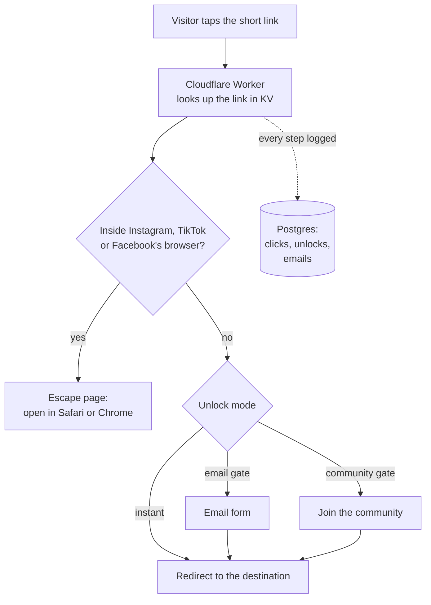

# Unlock

**Smart links for your bio: get every click to its destination, and turn it into a subscriber.**

> 🚧 **Work in progress.** The core works and is deployed at [unlock-psi-two.vercel.app](https://unlock-psi-two.vercel.app); features are still being added.

You paste any link (a YouTube video, a Notion doc, a Gumroad product), choose what the visitor has to do to unlock it, and share one short link anywhere. Unlock also spots visitors stuck inside Instagram's or TikTok's built-in browser and gets them into their phone's real browser, where logins, payments and downloads actually work.

---

## The problem

When someone taps a link in an Instagram bio, it doesn't open in Safari or Chrome. It opens inside Instagram's own **in-app browser**. That browser:

- often **breaks logins** (Google sign-in refuses to run inside it),
- **loses carts and downloads** when the visitor switches apps,
- and keeps them one swipe away from going back to scrolling.

So creators lose clicks they already earned.

## Real-world scenarios

| Who | What they share | How Unlock helps |
|---|---|---|
| 🎥 **A creator** | A free preset pack in their Instagram bio | **Email gate:** fans enter an email to get it, and the creator builds a mailing list they own. |
| 🛒 **A small brand** | A product page with checkout | **Instant link + in-app-browser escape:** shoppers land in Safari or Chrome, where payment and login work. |
| 🎮 **A community manager** | A giveaway or a guide | **Community gate:** visitors join the Discord, Telegram, Slack or WhatsApp group first. |
| 📊 **Anyone** | Any link | Every click, unlock and redirect is tracked, and collected emails export as a CSV for any mailing tool. |

---

## How it works



- **The redirect engine** is a Cloudflare Worker ([`worker/index.ts`](worker/index.ts)). It reads each link from Cloudflare KV, so redirects are fast everywhere, and it logs events in the background without ever slowing down or breaking a redirect.
- **The app** (Next.js) is where creators sign in, create links, pick the unlock mode, and see clicks and collected emails.
- **In-app browser detection** reads the browser's user agent for Instagram, TikTok and Facebook, and shows step-by-step instructions to open the link in the real browser.
- **Once unlocked, stays unlocked:** a cookie remembers the visitor, so they aren't asked twice.

## Built with

| Part | Technology |
|---|---|
| App | Next.js 16 (App Router), React 19, TypeScript, Tailwind CSS 4 |
| Sign-in | Clerk |
| Database | Postgres on Neon, with Drizzle ORM |
| Redirect engine | Cloudflare Workers + KV |
| Hosting | Vercel (app), Cloudflare (redirects) |

## Run it locally

```bash
npm install
npx drizzle-kit migrate         # create the database tables
npm run dev                     # app on http://localhost:3000
cd worker && npx wrangler dev   # the redirect engine, locally
```

You need a Neon `DATABASE_URL`, Clerk keys, and a Cloudflare account with a KV namespace (see [`worker/wrangler.toml`](worker/wrangler.toml)).

## What's next

- Custom short links
- Deeper analytics: where clicks come from, and unlock rates over time
- Paid plans for power users

---

Built by [Krish Viramgama](https://github.com/figureitoutkrish).
